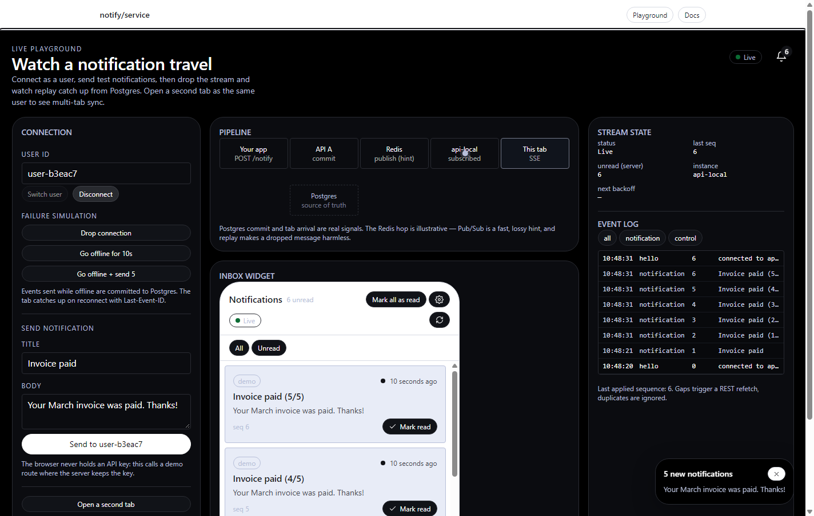

# Frontend: realtime notification widget + live playground

React 19 + TypeScript, Vite, TanStack Router/Query, Zustand, Radix primitives and GSAP.
It talks to the service in `../backend` and is built around the client side of the
replay protocol rather than around decorations.

## Run it

```bash
# terminal 1 (backend + Postgres + Redis)
docker compose up -d postgres redis        # from the repo root
cd backend && npm run migrate && npm run dev

# terminal 2
cd frontend && npm install && npm run dev
```

Open <http://localhost:5173/playground?user=user-42>. Vite proxies `/v1`, `/demo` and
`/health` to `http://localhost:3000`, so there is no CORS in development and the SSE
stream passes straight through. For a different backend, set `VITE_API_BASE`.

## What is implemented

**Surfaces**

- `/` — landing page: hero, five-step pipeline, replay explanation, SSE vs WebSocket,
  an embed snippet (GSAP reveals; static under reduced motion).
- `/playground` — the headline page: connection controls, failure simulation
  (drop / offline / offline + 5 sends), an honest pipeline diagram, a live event log,
  server-authoritative state strip, the inbox widget inline, and a two-tab helper.
- `/docs` — architecture notes and the API surface, mirroring the backend README.

**SDK components** (`src/sdk`)

`NotificationProvider`, `Bell`, `InboxPanel`, `NotificationItem`, `PreferencesPanel`,
`ConnectionPill`, `ToastHost`. The bell and panel are also embedded in the playground.

**Realtime client** (`src/realtime`)

- `StreamClient` owns reconnection: it uses `@microsoft/fetch-event-source` so it can
  send `Authorization` and `Last-Event-ID` (native `EventSource` can neither, and the
  backend's tickets are single-use). It calls `getToken()` before each attempt, refreshes
  once on a 401, backs off with full jitter, and resets after a stable connection.
- `SequenceTracker` classifies every notification as apply / duplicate / gap. Duplicates
  (replay + live overlap) are ignored; a gap triggers a REST refetch and the server
  becomes the source of truth again.
- `useNotificationStream` writes events into the TanStack Query cache (inbox pages),
  keeps the Zustand store in sync, and only announces *batches* and connection
  transitions through the single live region.
- Unread counts are never incremented locally: a notification triggers a refetch of the
  server's authoritative counter.

**Motion**

GSAP is registered once (`src/motion/gsap.ts`). Durations/eases live in
`src/motion/tokens.ts`. Flip animates list insertions without touching layout
properties and is skipped on bursts (>5 items/500ms); the bell rotates once on a new
notification; the pipeline packet travels on real signals (send → Postgres commit,
stream event → tab). Everything sits behind `prefers-reduced-motion`.

**Accessibility**

One politely-announced status region (no `aria-live` on the list), assertive alerts only
for session expiry, text-plus-icon status (never colour alone), focus preserved during
live insertions (with a "new notifications" jump pill when scrolled), keyboard-operable
popover and sheets, 44px touch targets, and scroll compensation so prepends do not move
the reader.

## Tests

```bash
npm test          # 27 Vitest tests: reconcile, backoff, parsing, store, announcer,
                  # toast coalescing, untrusted content and URL sanitising
npm run build     # tsc + vite build
```

There is also a dependency-free browser smoke test that drives Chrome over CDP:

```bash
# with backend and dev server running
node scripts/browser-check.mjs
```

It asserts the stream goes live, a send lands in the inbox, five sends made while
offline replay on reconnect (seq 6, six items), the event log has exactly one hello and
no duplicates, and that the console is clean. It writes `docs/playground.png`.



## Not built yet

The admin console (API keys, groups, webhooks, delivery status, metrics), Storybook, and
the Playwright suite are planned but not implemented. API types are hand-written in
`src/lib/types.ts`; the plan calls for generation from the backend OpenAPI document
(`/docs/json`), which is a small follow-up once the admin surface exists.
